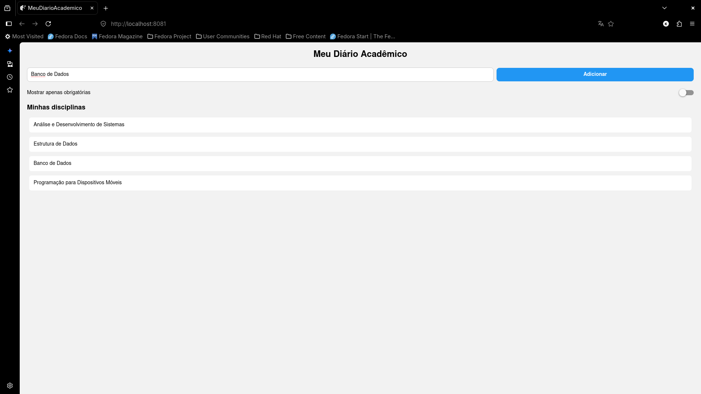

# Meu Diário Acadêmico

App criado para a Atividade 01 — Fundamentos de UI, Componentes e Layout (PDM/IESB).

## Comando usado para criar o projeto

\`\`\`bash
npx create-expo-app@latest MeuDiarioAcademico --template blank
npx expo install react-native-safe-area-context
\`\`\`

## Descrição

Tela inicial de cadastro rápido de disciplinas do semestre, com:

- Cabeçalho com o título do app
- Linha com TextInput (~70% de largura) e botão "Adicionar" (via Pressable, com estilo de pressionado)
- Switch "Mostrar apenas obrigatórias" (desafio opcional, ainda sem lógica de filtro)
- Lista estática de disciplinas renderizada com `.map`
- Rótulos organizados em `labels.js` e importados no `App.js`
- Estilos organizados via `StyleSheet.create`, com uso de `flex` e largura percentual (`%`)

## Print da tela

