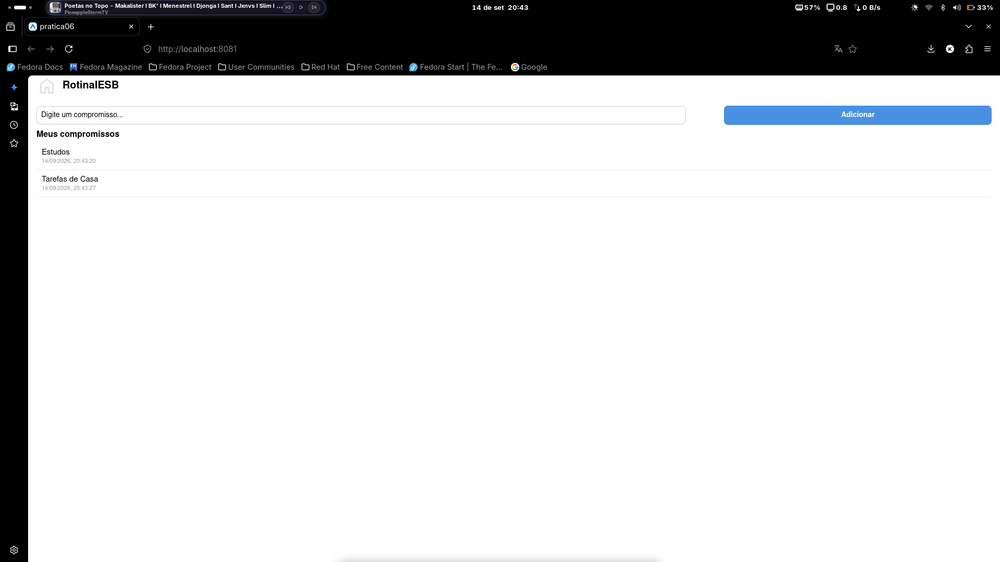

# RotinaIESB

Atividade Integradora — Programação para Dispositivos Móveis (aulas 02 a 06)
Professor Marcelo Alves Farias — IESB

## Comando usado para criar o projeto

npx create-expo-app@latest . --template blank
npx expo install @react-native-async-storage/async-storage react-native-safe-area-context

## Prints

### Tela 
()

## Mapa dos useEffect

- **useEffect de carga** (App.js, dependência `[]`): roda uma vez ao montar o
  componente, lê a chave `@rotina_iesb_compromissos` do AsyncStorage e
  preenche o estado `compromissos` com `JSON.parse`.
- **useEffect de salvamento** (App.js, dependência `[compromissos]`): roda
  toda vez que a lista de compromissos muda, salvando o estado atual no
  AsyncStorage com `JSON.stringify`.

## Arquivos criados

- `labels.js` — rótulos/textos do app (exports nomeados)
- `components/CompromissoInput.js` — formulário de cadastro (TextInput + Pressable)
- `components/CompromissoList.js` — lista de compromissos (FlatList)